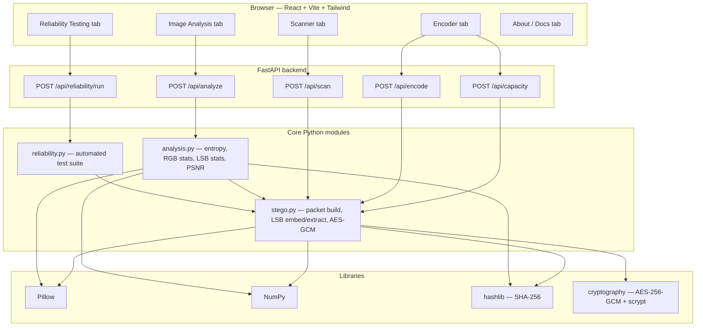
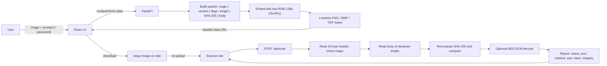
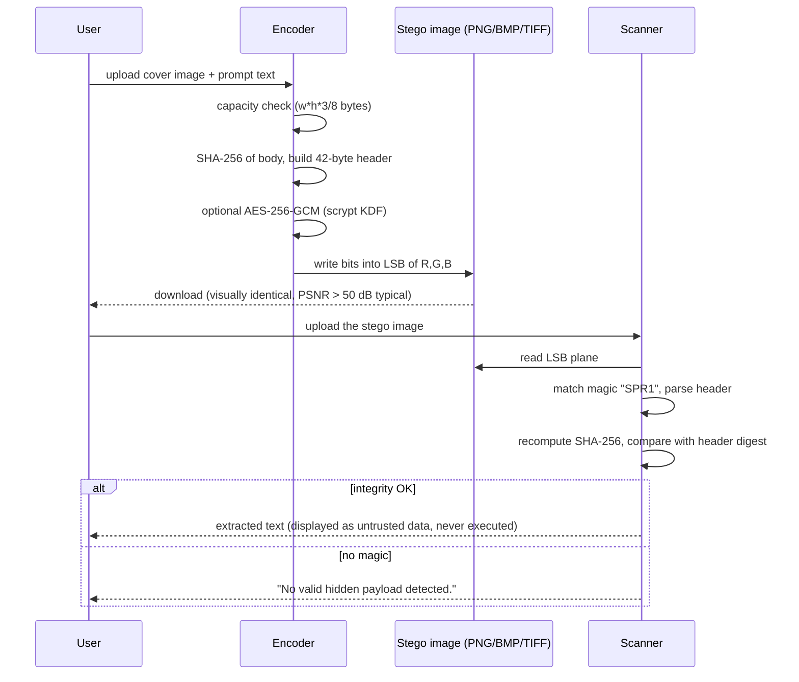

# SoftPrompt — Hidden Prompt Detection in Images

> **“See what the image doesn't show.”**
> An educational, **defensive** cybersecurity project that shows how text can be hidden inside an
> ordinary looking image with LSB steganography — and how a scanner detects and recovers it.

---

## Abstract

Multimodal AI systems accept images as input. An attacker can hide instructions inside an image that
look invisible to a human reviewer but may be recovered by tooling — a *soft prompt* smuggled through
an innocent looking picture. SoftPrompt demonstrates both halves of that story in a single
application: an **encoder** that embeds arbitrary UTF-8 text into the least significant bits of an
image's RGB samples, and a **scanner** that detects the payload, verifies its integrity with SHA-256
and extracts the text as inert, untrusted data. A statistical **image analysis** module and an
automated **reliability test suite** complete the toolkit. The suite really encodes, saves, reloads
and decodes every test image, so the reported success rate is measured, not asserted.

## Problem Statement

Images are treated as harmless media by most pipelines. They are, however, an excellent covert
channel: flipping the lowest bit of a colour sample changes it by at most 1/255, which no human eye
can perceive, while giving roughly `width × height × 3 / 8` bytes of hidden storage. There is no
built-in way for a student, analyst or reviewer to answer the simple question *“does this picture
carry a hidden prompt?”* — and no safe sandbox in which to study the technique.

## Objectives

1. Implement a real LSB steganography encoder for lossless image formats (PNG / BMP / TIFF).
2. Implement a scanner that detects the payload, verifies integrity and extracts the text.
3. Never execute, interpret or forward extracted text — always display it as untrusted data.
4. Provide statistical image analysis (entropy, RGB statistics, LSB distribution) as an *indicator*.
5. Measure reliability with an automated suite that computes the real success percentage.
6. Ship a clean, responsive, dark cybersecurity-themed dashboard.

## Proposed System

SoftPrompt is a two-tier application:

* **Backend (Python + FastAPI)** — owns all image processing. Pillow decodes/encodes files, NumPy
  performs the bit manipulation, `hashlib` provides SHA-256 integrity and `cryptography` provides
  optional AES-256-GCM password protection.
* **Frontend (React + Vite + Tailwind CSS)** — a five-tab dashboard (Encoder, Scanner, Image
  Analysis, Reliability Testing, About/Docs) with drag-and-drop upload, live capacity meters,
  progress indicators and side-by-side previews.

Nothing is mocked: every button calls a real endpoint that does real work on real pixels.

## System Architecture



## Data Flow



## Encoder → Image → Scanner workflow



## Modules

| Module | File | Responsibility |
| --- | --- | --- |
| Stego engine | `backend/app/stego.py` | Packet format, LSB embed/extract, AES-256-GCM, capacity maths |
| Analysis | `backend/app/analysis.py` | SHA-256, Shannon entropy, RGB statistics, LSB distribution, PSNR |
| Reliability | `backend/app/reliability.py` | 20 automated cases, real encode→save→reload→decode round trips |
| API | `backend/app/main.py` | FastAPI endpoints, upload validation, error handling |
| CLI runner | `backend/run_tests.py` | Runs the suite from the terminal and prints the measured success rate |
| Unit tests | `backend/tests/test_softprompt.py` | pytest coverage of the engine and the HTTP API |
| UI shell | `frontend/src/App.tsx` | Dashboard layout, tab navigation, API health indicator |
| UI pages | `frontend/src/pages/*.tsx` | Encoder, Scanner, Analysis, Testing, About |
| UI kit | `frontend/src/components/ui.tsx` | Cards, badges, drag-and-drop zone, progress bars, spinners |

## Technologies Used

| Layer | Technology |
| --- | --- |
| Frontend | React 19, TypeScript, Vite, Tailwind CSS |
| Backend | Python 3.10+, FastAPI, Uvicorn |
| Image processing | Pillow, NumPy |
| Integrity | `hashlib` SHA-256 |
| Optional encryption | `cryptography` — AES-256-GCM with scrypt key derivation |
| Testing | pytest, custom reliability suite |

## LSB Steganography explained

Every pixel of an RGB image stores three 8-bit samples. The **least significant bit** contributes a
value of 1 out of 255 (~0.4 %) to a channel, so rewriting it is imperceptible:

```
original red channel : 1 0 1 1 0 1 1 [0]   = 182
hidden bit           :               [1]
modified red channel : 1 0 1 1 0 1 1 [1]   = 183   <- visually identical
```

With one bit per channel an image holds:

```
capacity_bytes = width × height × 3 ÷ 8
```

A 1920×1080 photo therefore carries about **777 KB** of hidden data. SoftPrompt writes bits
most-significant-bit first, scanning the image row by row and R→G→B within each pixel. The alpha
channel is never modified, so transparency is preserved bit-for-bit.

### Packet format

```
offset  size  field
0       4     magic      b"SPR1"
4       1     version    1
5       1     flags      bit0 = body is AES-256-GCM encrypted
6       4     body_len   big-endian length of body
10     32     digest     SHA-256 of body exactly as embedded
42      N     body       UTF-8 text, or salt(16) | nonce(12) | ciphertext
```

The 42-byte header is what makes detection deterministic: the scanner reads the first 336 LSBs, and
if they do not begin with `SPR1` it reports **“No valid hidden payload detected.”**

## Encoder working

1. Upload a cover image; the backend reports dimensions, format and capacity.
2. Type the prompt. A live meter shows payload bytes vs capacity and blocks oversized payloads.
3. Optionally set a password — the body is encrypted with AES-256-GCM using a scrypt-derived key
   (N=2¹⁴, r=8, p=1) and a random 16-byte salt and 12-byte nonce.
4. SHA-256 of the body is computed and stored in the header.
5. NumPy clears the LSB of each channel (`& 0xFE`) and ORs in the payload bits.
6. The result is saved as PNG, BMP or TIFF and returned as a base64 data URL for preview and
   download, together with both SHA-256 hashes and the PSNR against the original.

## Scanner working

1. Upload any image.
2. The scanner reads the LSB plane and checks for the `SPR1` magic.
3. It parses version, flags and body length, and sanity-checks the length against capacity.
4. It reads the body, recomputes SHA-256 and compares it with the stored digest → **integrity
   status**.
5. If the payload is encrypted, AES-GCM decrypts it (the GCM tag also authenticates it); a wrong
   password is reported, never guessed around.
6. The report shows detection status, extracted text, encoding method, payload size, image
   information, the file's SHA-256 and the checksum status.

> The extracted text is rendered inside a plain `<pre>` block. It is never executed, never sent to an
> AI service, and never interpreted as an instruction by the application.

## Testing

Two independent layers:

```bash
# 1. unit + API tests
cd backend && .venv/bin/python -m pytest -q

# 2. reliability suite (also available in the UI and as JSON over HTTP)
cd backend && .venv/bin/python run_tests.py
```

The reliability suite builds synthetic cover images (flat, gradient, photo-like, pure noise, RGBA),
encodes messages of many shapes (short ASCII, 2000-character prompts, Unicode + emoji, multiline
text, capacity-edge payloads, encrypted payloads), **saves each to its real file format, reloads it
from those bytes and decodes it again**. A case passes only when the recovered text is byte-identical
to the original and the checksum validates.

It also includes deliberate *negative* cases, which pass only when SoftPrompt correctly refuses:

* JPEG re-compression must destroy the payload,
* a clean image must not produce a false positive,
* a wrong password must not yield plaintext,
* tampered pixels must fail the checksum,
* an oversized payload must be rejected at encode time.

## Results

Measured on this machine with `python run_tests.py` (20 cases, one repeat each):

```
Total tests : 20
Passed      : 20
Failed      : 0
Success rate: 100.0%
```

Typical PSNR between cover and stego image is **> 50 dB** (differences invisible to the eye).
Re-run the suite yourself — the numbers in the UI are computed live from the actual runs, never
hard coded. Recovery is reliable for the supported case (lossless container, unmodified pixels);
it is *expected* to fail for lossy or edited images, which the suite verifies explicitly.

## Limitations

* Lossy re-encoding (JPEG, WebP-lossy) destroys the payload; so do resize, crop, rotate and filters.
* Detection recognises only the SoftPrompt container. Other steganography tools use other formats.
* Statistical indicators cannot prove an image is clean — a low-rate embedding hides inside natural
  sensor noise, and clean noisy photos already have a near-50/50 LSB plane.
* Capacity is 1 bit per channel (~1 byte per 2.67 pixels); no adaptive or edge-aware embedding.
* Payloads are stored in a fixed scan order, so a targeted adversary who knows the format could
  strip them by randomising the LSB plane.

## Future Scope

* Multi-bit-plane and adaptive (edge-aware) embedding with a quality/capacity trade-off slider.
* Robustness against resizing and JPEG via DCT-domain embedding.
* Stronger steganalysis: RS analysis, sample-pair analysis, per-block chi-square maps.
* Batch scanning of folders, plus a CLI and CI action for asset pipelines.
* Support for other carriers (audio WAV, PDF metadata) with the same packet format.

## Conclusion

SoftPrompt is a complete, working demonstration of hidden-prompt risk in images. The encoder produces
genuinely steganographic files, the scanner genuinely recovers and verifies them, the analysis module
gives an honest (and honestly caveated) statistical picture, and the reliability suite reports a
measured success rate rather than a claimed one. Everything runs locally, offline, and treats
recovered text strictly as untrusted data.

---

## Project structure

```
softprompt/
├── backend/
│   ├── app/
│   │   ├── __init__.py
│   │   ├── analysis.py       # entropy, RGB stats, LSB distribution, PSNR
│   │   ├── main.py           # FastAPI endpoints
│   │   ├── reliability.py    # automated test suite
│   │   └── stego.py          # LSB engine + packet format + AES-GCM
│   ├── tests/test_softprompt.py
│   ├── requirements.txt
│   └── run_tests.py
├── frontend/
│   ├── src/
│   │   ├── components/ui.tsx
│   │   ├── pages/{Encoder,Scanner,Analysis,Testing,About}.tsx
│   │   ├── api.ts  types.ts  App.tsx  main.tsx  index.css
│   ├── tailwind.config.js  vite.config.ts  package.json
└── README.md
```

## Getting started

### 1. Backend

```bash
cd backend
python3 -m venv .venv
.venv/bin/pip install -r requirements.txt
.venv/bin/uvicorn app.main:app --reload --port 8000
```

Interactive API docs: <http://127.0.0.1:8000/docs>

### 2. Frontend

```bash
cd frontend
npm install
npm run dev          # http://localhost:5173  (proxies /api to port 8000)
```

Set `SOFTPROMPT_API` if the backend runs elsewhere, e.g.
`SOFTPROMPT_API=http://127.0.0.1:9000 npm run dev`.

### 3. Try the full workflow

1. **Encoder** → drop a PNG → type a prompt → *Encode & embed* → *Download encoded image*.
2. **Scanner** → drop the downloaded file → *Scan image* → the prompt is recovered with a valid
   checksum.
3. **Image Analysis** → compare the LSB statistics of the original and the encoded file.
4. **Reliability Testing** → *Run test suite* → read the measured success rate.

## API reference

| Method | Path | Purpose |
| --- | --- | --- |
| GET | `/api/health` | Service check |
| POST | `/api/capacity` | Dimensions, format, capacity, SHA-256 of an upload |
| POST | `/api/encode` | Embed `message` (optional `password`, `output_format`) |
| POST | `/api/scan` | Detect + extract a payload (optional `password`) |
| POST | `/api/analyze` | Statistical analysis report |
| POST | `/api/reliability/run?repeats=N` | Run the suite, return real pass/fail counts |

## Ethics and safety

This project is for **education and defence only**. It does not connect to any AI service, does not
execute hidden prompts, does not bypass any security control and performs no attacks. Extracted text
is always treated as untrusted data. Use it on images you own or are authorised to analyse.
